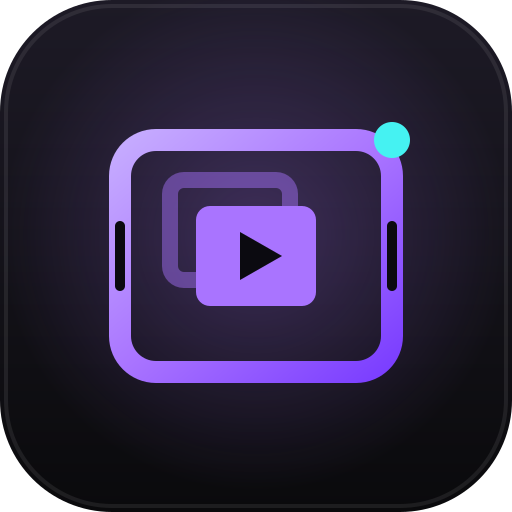
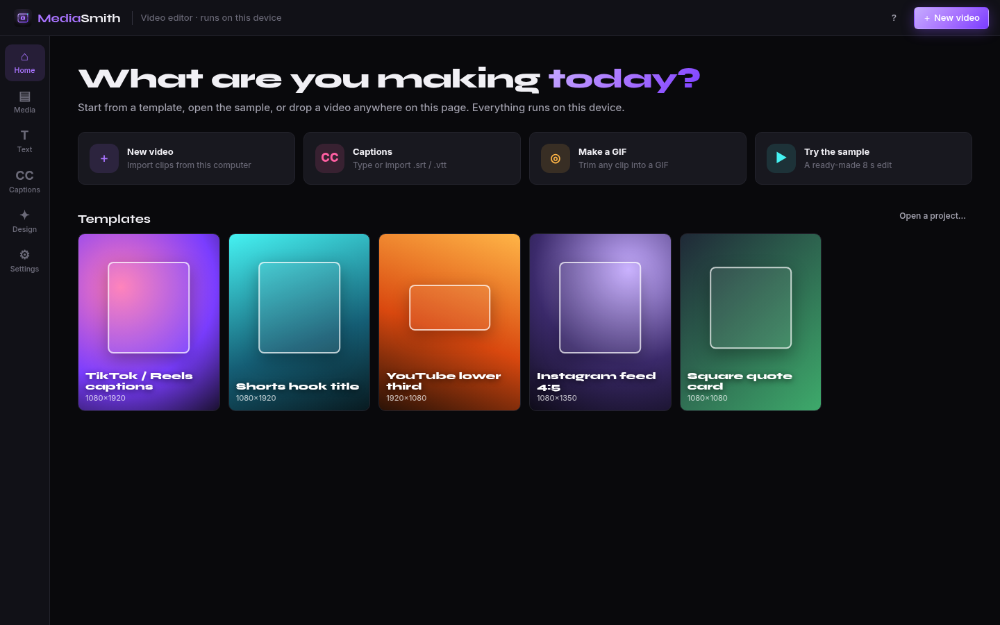
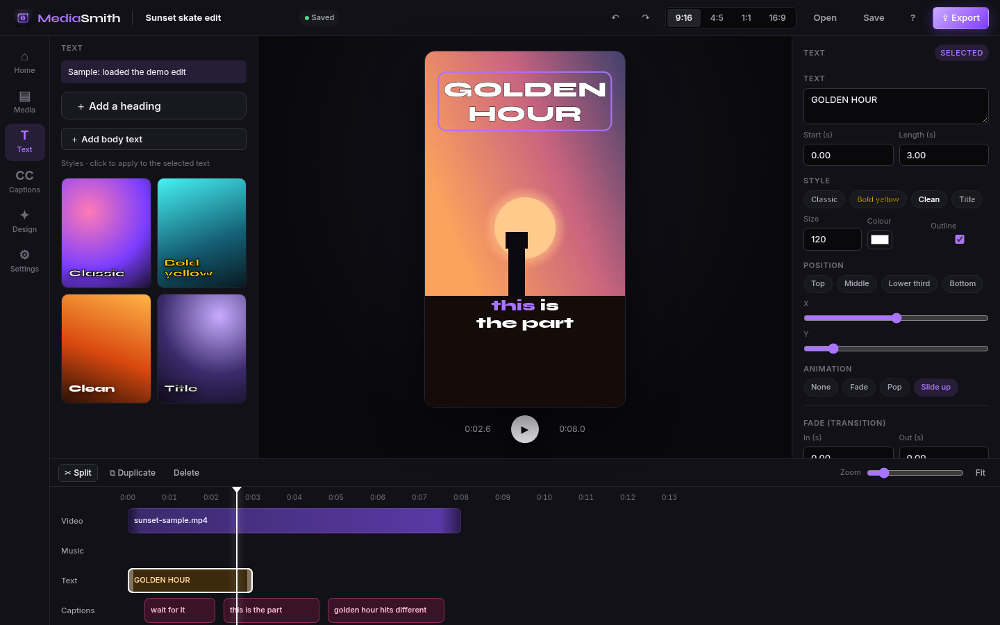
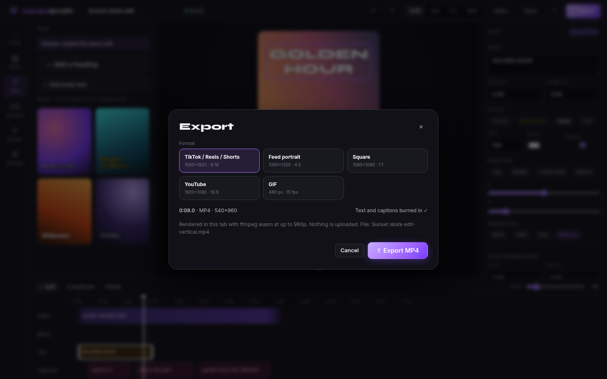
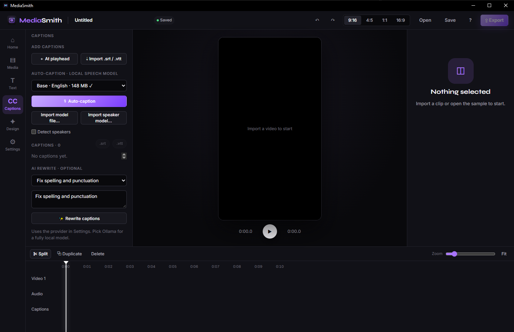
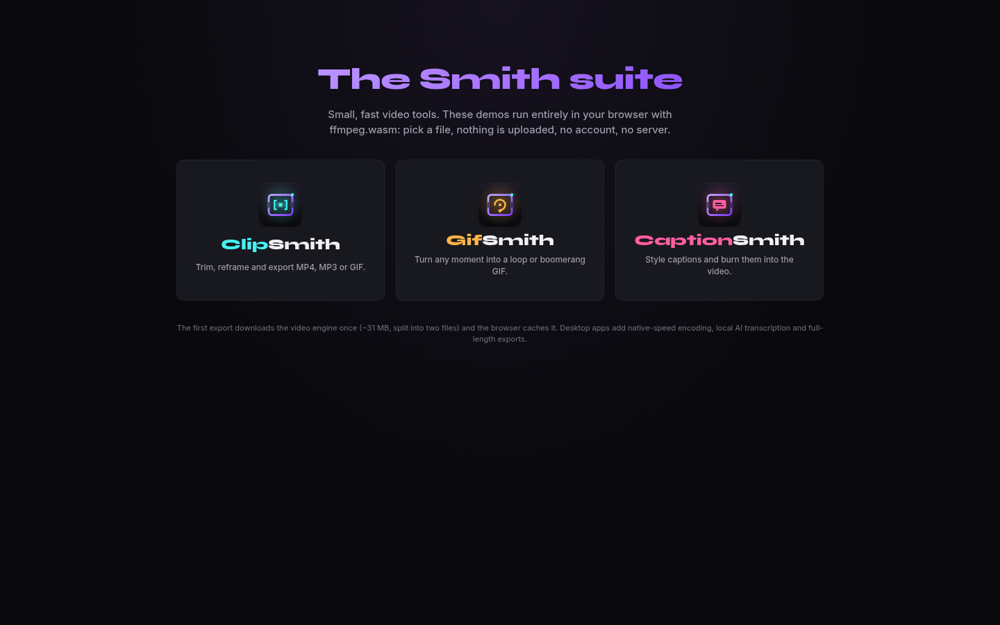
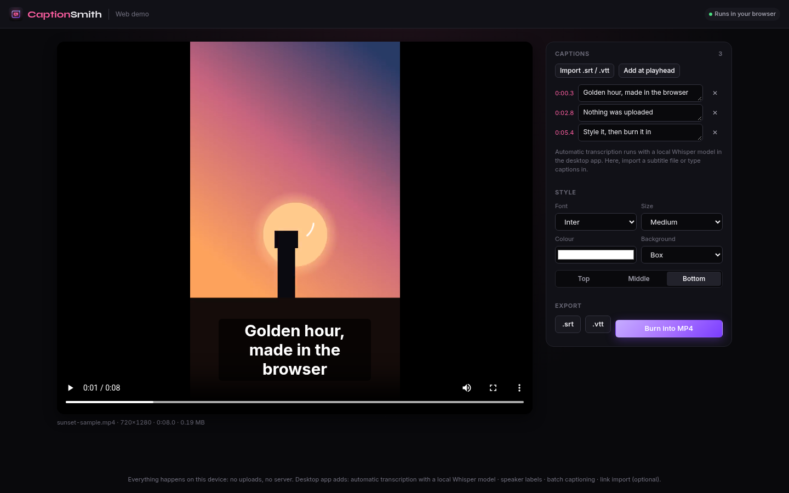

<p align="center">
  
</p>

<h1 align="center">MediaSmith</h1>

<p align="center">An open-source, local-first CapCut / Canva for the desktop and the browser.</p>

MediaSmith merges the Smith apps, [ClipSmith](https://github.com/ccharafeddine/ClipSmith),
[GifSmith](https://github.com/ccharafeddine/GifSmith) and
[CaptionSmith](https://github.com/ccharafeddine/CaptionSmith), into one editor. Import
a file, cut on a multi-track timeline, add text and karaoke captions, reframe for
vertical, and export to TikTok, Reels, Shorts, YouTube or GIF. There are no accounts,
no watermark and no cloud.

Licensed GPL-3.0-or-later. Built with Tauri 2, Rust, SolidJS and FFmpeg.

<p align="center">
  
</p>
<p align="center">
  
</p>
<p align="center">
  
  
</p>

## Features

- **Home:** templates by platform (TikTok/Reels, Shorts, YouTube, Instagram 4:5, square), quick actions, recovery of the last project, drag a file anywhere, and a bundled sample project.
- **Editor:** a tool rail (Media, Text, Captions, Design, Settings), a player with aspect switching (9:16, 4:5, 1:1, 16:9) and an inspector. The timeline supports split, duplicate, delete, zoom, fit and snapping. Undo/redo and `.msproj` save/open are included.
- **Text:** style presets, colours, position, and fade, pop or slide animations.
- **Captions:**
  - Whisper auto-captions run locally, with karaoke word highlighting and speaker labels.
  - SRT/VTT import and export.
  - AI rewrite is optional, with local Ollama as the default provider.
- **Export:** 9:16, 4:5, 16:9 and 1:1 MP4, plus GIF, with progress. Text and captions are burned in.

## Works offline

Every feature has a local path. You never need an internet connection or an account.

- Media comes in from local files, always. Link import (yt-dlp) is optional.
- The Whisper base model ships with the app. **Import model file…** and **Import speaker model…** install models you already have from disk, verified by SHA-256.
- AI features are optional. Ollama on localhost is the default, and without a provider they just stay disabled.
- Fonts, icons, the sample clip and the web video engine are all bundled. Nothing loads from a CDN.

The rules are in [`docs/design-system.md`](docs/design-system.md#9-offline-first).

## Web demos

The editor's web demo is meant for **media.chafic.me**, with the sibling demos at clip, gif and
caption .chafic.me. A ready-to-host build of this one is committed in [`web/dist/`](web/dist)
(rebuild with `SMITH_SITE=media npm run build -w @mediasmith/app`). Hosting notes, the headers
it needs and listing assets are in [`docs/hosting.md`](docs/hosting.md).

Both builds are static. They use ffmpeg.wasm with local files only: no server and no uploads.

| Build | Command | Output |
|---|---|---|
| Editor | `npm run build -w @mediasmith/app` | `app/dist/` (~33 MB) |
| ClipSmith, GifSmith, CaptionSmith demos | `npm run build -w @mediasmith/smiths-web` | `apps/smiths-web/dist/` (~33 MB) |

The ~31 MiB wasm core is split into parts under Cloudflare Pages' 25 MiB per-file
limit and joined at runtime. [`docs/web.md`](docs/web.md) lists what works in the
browser and what is desktop only.

<p align="center">
  
  
</p>

## Install and build

```sh
npm install
npm run dev:web                       # editor in a browser
scripts/fetch-sidecars.sh             # desktop sidecars: ffmpeg, yt-dlp, whisper (gitignored)
npm run tauri dev                     # desktop app
npm run tauri -- build                # installers (NSIS, MSI) in target/release/bundle
npm run tauri -- build --debug        # dev build: target/debug/mediasmith.exe
cargo test --workspace && npm run typecheck && npm test
```

## Layout

```
crates/
  ms-media/     ffprobe parsing, ffmpeg runner, hardware encoder selection (from ClipSmith)
  ms-import/    yt-dlp routing + generic any-site scrape fallback (from ClipSmith v2.1.0)
  ms-project/   timeline model: tracks, clips, text and caption layers, JSON save/load
app/            SolidJS editor UI (Vite)
  src-tauri/    thin Tauri 2 shell; each command delegates to a crate
packages/
  ui/           Smith design system v2: tokens, sm- components, brand marks, fonts, sample clip
  platform/     platform adapter: Tauri invoke on desktop, ffmpeg.wasm in a browser
apps/
  smiths-web/   static browser demos of ClipSmith, GifSmith, CaptionSmith (ffmpeg.wasm)
docs/           design mockups, web feasibility notes
scripts/        sidecar fetchers (ffmpeg, yt-dlp); binaries are gitignored
```

## Roadmap

**Phase 1, scaffold (done, `scaffold/phase-1`).** Monorepo, ported ClipSmith core and import,
project model, an editor shell with mock timeline, platform adapter, web GIF demo, CI.

**Phase 2, a usable editor (done, `feat/phase-2`; phase 3 export overlays, snapping, filmstrips and first AI feature on `feat/phase-3`).** Real playback from the project model; file and
link import; two video tracks plus audio and captions; trim, split, move and snapping;
export through ffmpeg with presets; save and open `.msproj`.

**Phase 3, tools.** Port ClipSmith reframe (face/person tracking), GifSmith palette
GIF export, CaptionSmith whisper captions with styles and word highlighting; crossfades.

**Phase 4, Design.** A Canva-style canvas: templates, text, shapes and stickers,
thumbnails and cover frames, brand kit.

**Phase 4b, bring-your-own-key AI.** Settings > AI providers (OpenAI, Gemini,
Anthropic, OpenAI-compatible including local Ollama). Keys live in the OS keychain
(`keyring` crate, never plain JSON), and requests go straight from the app to the
provider. Features: AI thumbnails from chosen video frames as editable Design layers,
title and description ideas, caption rewrite, best-moment clip picks. See
[`docs/ai.md`](docs/ai.md), which also covers the web caveats (browser key storage, CORS).

**Later.** Plugin API so future Smith tools drop in as modules, signed installers and
updates, GPU preview compositor, macOS and Linux builds.

See [`docs/web.md`](docs/web.md) for what runs in the browser and
[`docs/mockups/`](docs/mockups) for the proposed look.
